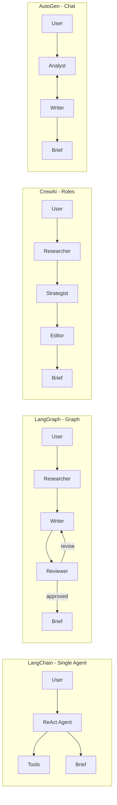

# Agentic AI Workflows (Single & Multi-Agent)

A hands-on portfolio lab for **LangChain**, **LangGraph**, **CrewAI**, and **AutoGen**. Each example solves the same business task—produce a **market research brief**—using a different orchestration style so you can compare frameworks in interviews and on your resume.

## What you get

| Example | Framework | Pattern | Best for demonstrating |
|---------|-----------|---------|------------------------|
| `01_langchain_single_agent` | LangChain | Single ReAct agent + tools | Tool use, agent loops, minimal orchestration |
| `02_langgraph_multi_agent` | LangGraph | Researcher → Writer → Reviewer graph | Explicit state, conditional routing, retries |
| `03_crewai_multi_agent` | CrewAI | Role-based sequential crew | Task delegation, role prompts, pipelines |
| `04_autogen_multi_agent` | AutoGen | Round-robin conversation | Multi-agent dialogue, emergent collaboration |

## Quick start

```bash
cd "/Users/oscarvalles/Agentic AI workflows (single:multi-agent) "
# Note: ':' in the folder name breaks `python -m venv` on macOS — use /tmp venv:
python3 -m venv /tmp/agentic-workflows-venv
source /tmp/agentic-workflows-venv/bin/activate
pip install -r requirements.txt
cp .env.example .env
```

### Run without API keys (mock mode)

```bash
export MOCK_LLM=1
python run.py all
```

### Run with OpenAI

```bash
# In .env: OPENAI_API_KEY=sk-...
unset MOCK_LLM   # or MOCK_LLM=0
python run.py langgraph --topic "Generative AI in healthcare"
```

### Run a single example

```bash
python -m examples.01_langchain_single_agent
python -m examples.02_langgraph_multi_agent
python -m examples.03_crewai_multi_agent
python -m examples.04_autogen_multi_agent
```

## Architecture (same problem, four styles)



## Project layout

```
shared/           # Config, mock LLM, shared research tools
examples/         # Four runnable demos
run.py            # Menu CLI
requirements.txt
.env.example
```

## Framework cheat sheet (interview-ready)

**LangChain** — You define *one* agent that decides when to call tools. Great default for RAG + actions.

**LangGraph** — You define *nodes and edges*; state is first-class. Use when workflows have branches, loops, or human-in-the-loop.

**CrewAI** — You define *roles and tasks*; the framework sequences work. Fastest path to readable multi-agent pipelines.

**AutoGen** — Agents *talk* until termination. Strong for exploratory tasks and critique/revise loops.

## Resume bullet ideas

- Built comparable **single- and multi-agent** workflows across LangChain, LangGraph, CrewAI, and AutoGen for market research automation.
- Implemented **LangGraph** conditional routing (review/revise loop) with shared tool-backed state.
- Designed **CrewAI** sequential crews with role-specific agents and task context chaining.

## Notes

- **Mock mode** uses `FakeListChatModel` for LangChain/LangGraph/CrewAI; AutoGen prints a simulated transcript.
- Tools use a **deterministic knowledge base** (no live web scraping) so demos are reliable.
- For production, add observability (LangSmith, OpenTelemetry), auth for tools, and evaluation harnesses.

## License

MIT — use freely for learning and portfolio projects.
